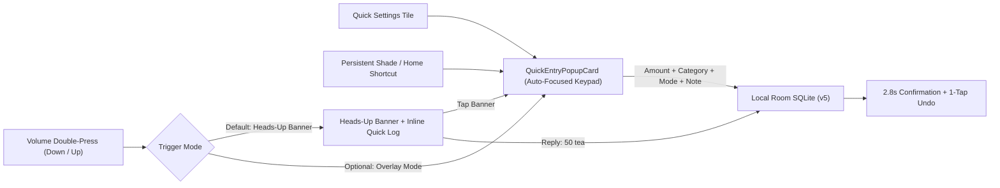

<div align="center">

<h1>TapLedger</h1>

<p>
  <strong>Private, 100% offline-first Android expense tracker built for &lt; 3 second capture.</strong><br />
  Log daily spending with a double-press of your Volume button, track Cash vs. Digital splits, and understand every rupee.
</p>

<p>
  <a href="https://github.com/Sonawanemayur-IT/TapLedger/releases">
    
  </a>
  
  
  
</p>

<p>
  <a href="#why-tapledger">Overview</a> ·
  <a href="#quick-capture-flow">Quick Capture</a> ·
  <a href="#inside-the-app">5 Core Screens</a> ·
  <a href="#cash-wallet--insights">Cash Wallet & Insights</a> ·
  <a href="#privacy--permissions">Privacy</a> ·
  <a href="#download--install">Download & Setup</a>
</p>

</div>

---

> [!IMPORTANT]
> **Launcher Name & Distribution**  
> - **App Drawer Name:** After installing the APK, look for **Quick Expense** in your Android launcher (`com.quickexpense.app.debug` / `com.quickexpense.app`, version `1.0.0`).  
> - **Public Distribution:** This repository contains documentation and packaged Android APK releases only; application source code is not published here.

---

## Why TapLedger?

Most expenses aren't lost to big purchases — they vanish in ₹20 chai, ₹60 auto rides, and quick UPI scans that never make it into a tracker. **TapLedger** eliminates logging friction so capturing an expense takes **under 3 seconds**, while giving you deep offline analytics without ever requesting internet access.

| Pillar | What You Get |
| :--- | :--- |
| **Zero-Friction Capture** | Double-press **Volume Down / Up**, type right inside a heads-up notification (`50 tea`), tap the **Quick Settings Tile**, use the **Persistent Shade Indicator**, or open from a pinned **Home Shortcut**. |
| **100% Offline Privacy** | `android.permission.INTERNET` is completely omitted from `AndroidManifest.xml`. No accounts, no cloud servers, no ads, no analytics SDKs. |
| **Cash + Digital Clarity** | Separates **Cash**, **UPI**, **Debit Card**, **Credit Card**, and **Other**, paired with a dedicated **Cash Wallet** so ATM withdrawals and cash gifts never inflate spending totals. |
| **Actionable Financial Lens** | Includes a **Did You Know?** tab that translates your trailing 30-day spending pace into monthly, daily, working-day, and hourly take-home income targets. |
| **Warm Graphite + Soft Amber UI** | Crafted in Material 3 & Jetpack Compose with tabular numerals (`tnum`), crisp `1 dp` hairline cards, spring-physics animations, and **Light / Dark / System** themes. |

---

## Quick Capture Flow



### Capture Features Built for Speed

- **Auto-Focused Numeric Pad:** Opens directly to the amount field (`80 ms` focus request) with live Indian numbering grouping (`1,00,000.5` for `INR`, standard 3-digit grouping for other currencies).
- **Smart Pre-Selection:** Remembers your `lastUsedCategoryId` and `lastUsedPaymentMode`, surfaces your top 8 categories by usage frequency & recency, and expands to all active categories on tap.
- **Note-Matched Suggestions:** Typing a note (`>= 2` characters) locally matches your own past confirmed expenses to suggest the right category — zero hardcoded guesses or cloud AI.
- **Non-Blocking Safety Guardrails:**
  - **2-Minute Duplicate Warning:** Alerts gently if an identical `(amount, category, payment mode)` entry was logged within the last 120 seconds, without blocking save.
  - **Negative Cash Warning:** Flags when a `Cash` entry will take your Cash Wallet balance below zero.
- **Instant Undo:** Every saved entry (via popup, notification inline reply, or Ledger delete) supports immediate one-tap **Undo**.

---

## Inside the App

TapLedger organizes everything into five focused bottom-navigation tabs plus dedicated Category Management:

### 1. Overview (`Home`)
- **Shortcut Status Pill:** Live `Shortcut Ready` / `Setup Shortcut` chip linking directly to permission configuration.
- **Today's Spending Hero Card:** Animated tabular total (`TODAY'S SPENDING`), entry counter, **Quick** button, and **THIS WEEK / THIS MONTH** split.
- **Cash Wallet Card:** Displays live cash-in-hand, total cash added, and cash spent since your as-of date, with **Add Cash**, **Cash Ledger**, and **Starting Cash** actions.
- **Legacy Mode Cleanup:** Detects any entries with `Unspecified` payment mode and offers a one-tap **Bulk Assign** dialog.
- **Monthly Budget Progress:** Color-adaptive progress bar (accent `< 75%`, warning `75%–99%`, danger `>= 100%`).
- **14-Day Trend & Top Categories:** Compact 14-day bar chart highlighting today and peak day, top 5 categories with percentage shares, and recent expenses tagged by capture source (`Volume`, `Notification`, `Tile`, `Shortcut`).

### 2. Ledger (`History`)
- **Live Search:** Search simultaneously across notes, category names, and payment mode labels.
- **Multi-Axis Filter Chips:** Combine **Date** (`All`, `Today`, `This Week`, `This Month`), **Category**, and **Payment Mode** (`Cash`, `UPI`, `Debit Card`, `Credit Card`, `Other`, `Unspecified`).
- **Sort Cycling:** Toggle between **Newest**, **Oldest**, and **Highest** amount.
- **Date-Grouped Feed:** Clean `TODAY` / `YESTERDAY` / date section headers with daily totals, tap-to-edit modal (`EditExpenseDialog`), and one-tap delete with **Undo**.

### 3. Did You Know? (`Earning Targets`)
Turns your last **30 local calendar days** of expenses (excluding Cash Additions) into tangible take-home income targets using exact `BigDecimal` `HALF_UP` rounding:

| Metric | Formula | Purpose |
| :--- | :--- | :--- |
| **Monthly Target** | Net 30-day spend | Estimated monthly take-home needed to sustain your pace |
| **Daily Target** | `Monthly Target ÷ 30` | Average daily calendar spend |
| **Working-Day Target** | `Monthly Target ÷ 22` | Equivalent earnings per working day (`22 days/mo`) |
| **Hourly Target** | `Monthly Target ÷ 176` | Equivalent take-home rate (`22 days × 8 hrs/day`) |

Includes **Preliminary Estimate** notices when history has fewer than 30 days or fewer than 5 entries, plus expandable step-by-step calculations.

### 4. Insights (`Analytics`)
- **Key Metrics & MoM Comparison:** `Avg. Daily (MTD)`, `Top Category`, and same-day-range **Month-to-Month** comparison (`Days 1–N` this month vs. `1–N` last month).
- **Cash vs. Digital Split:** Stacked visual bar comparing **Cash** vs. **Digital** (`UPI` + `Debit Card` + `Credit Card`), keeping `Other` and `Unspecified` separate.
- **Payment Modes Breakdown:** Transaction count, total spend, and share percentage per mode.
- **Interactive Charts:** Switch seamlessly between **Daily** (`14 days`), **Weekly** (`6 weeks`), and **Monthly** (`6 months`) views with period total and peak highlights.
- **Budgeting & Recurring Detection:** Set overall monthly + per-category budgets (`75% / 90% / 100%` alerts), view **Highest Spending Days**, and review read-only **Recurring Expense Suggestions** (`>= 3` consistent Weekly, Biweekly, or Monthly entries sharing a category and note).

### 5. Settings & Category Management
- **Category Manager:** 14 pre-seeded categories (`Food & Dining`, `Groceries`, `Transportation`, `Shopping`, `Stationery`, `Education`, `Entertainment`, `Health`, `Bills & Utilities`, `Rent`, `Travel`, `Personal Care`, `Subscriptions`, `Other`), unlimited custom categories, `15` vector icons, `10` accent colors, up/down custom ordering, per-category monthly limits, and archive/restore support.
- **Gentle Personalized Evening Check-In:** `WorkManager`-backed daily reminder inside a configurable window (default `7:30 PM – 9:30 PM`), respecting quiet hours (default `10:30 PM – 7:00 AM`), rotating friendly messages, skipping if already logged, offering **Snooze** (`30 min`) / **Dismiss**, and adapting locally after `>= 7` timing signals.
- **Summaries & Alerts:** Optional `9:00 PM` End-of-Day summary, Weekly recap, and Monthly Budget threshold notifications.
- **Appearance & Currency:** `System`, `Light`, and `Dark` themes; supports `INR ₹` (`Asia/Kolkata` default), `USD $`, `EUR €`, and `GBP £`.
- **CSV & JSON Portability (`BackupCodec` v2):** Export/Share CSV (`EXPENSE`, `CASH_STARTING`, `CASH_ADDITION` rows) and full JSON backup/restore with UID deduplication.

---

## Cash Wallet & Insights

Cash-in-hand is always derived dynamically from database records rather than mutable counters:

```text
Cash Balance = Starting Cash
             + SUM(Cash Additions dated >= As-Of Date)
             − SUM(Expenses where PaymentMode == CASH and dated >= As-Of Date)
```

- **Cash Additions** (**ATM withdrawal**, **Gift**, **Other**) replenish your wallet without distorting spending charts or `Did You Know?` calculations.
- **Digital Modes** (`UPI`, `Debit Card`, `Credit Card`) and `Other` never deduct from your Cash Wallet balance.

---

## Design Identity

TapLedger uses a calm, high-contrast **Warm Graphite + Soft Amber** palette engineered for AMOLED readability:

| Token | Light Theme | Dark Theme | Role |
| :--- | :--- | :--- | :--- |
| `canvas` | `#F5F3EE` | `#121110` | App root background |
| `surfacePrimary` | `#FCFBF8` | `#1B1917` | Cards, quick-entry panel, bottom bar |
| `surfaceSecondary` | `#ECE8DF` | `#25221F` | Inset inputs, chips, chart tracks |
| `hairline` | `#DFDAD0` | `#332F2B` | `1 dp` borders & dividers |
| `inkPrimary` | `#1C1A17` | `#F5F2EC` | Headings, monetary totals |
| `accent` | `#B4690E` | `#E5A93C` | Primary CTAs, active indicators, trends |

---

## Privacy & Permissions

> [!NOTE]
> TapLedger declares **zero network permissions** (`INTERNET` is intentionally excluded from `AndroidManifest.xml`), sets `android:allowBackup="false"`, and keeps all data in local Room SQLite (`quick_expense.db`).

<details>
<summary><strong>View Full Android Permissions Breakdown</strong></summary>

<br />

| Permission | Purpose | Required? |
| :--- | :--- | :--- |
| `INTERNET` | **Omitted** — impossible for the app to transmit data over a network. | Never |
| `POST_NOTIFICATIONS` | Heads-up shortcut banners, inline quick log, evening check-ins, and budget alerts. | Optional (Recommended) |
| `BIND_ACCESSIBILITY_SERVICE` | Listens solely for configured Volume key double-presses (`canRetrieveWindowContent="false"`, single presses pass through normally). | Optional |
| `SYSTEM_ALERT_WINDOW` | Only needed if switching Trigger Experience from *Heads-Up Banner* to *Overlay Panel*. | Optional |
| `FOREGROUND_SERVICE` / `SPECIAL_USE` | Direct overlay service and persistent quick-add shade notification. | Optional |
| `RECEIVE_BOOT_COMPLETED` | Reschedules WorkManager check-in and summary notifications after device reboot. | Automatic |
| `REQUEST_IGNORE_BATTERY_OPTIMIZATIONS` | Direct shortcut for OxygenOS users to allow unrestricted background execution. | Optional |
| `VIBRATE` | Haptic pulse on double-press detection and expense save. | Automatic |

</details>

---

## Download & Install

1. Visit the **[Releases](https://github.com/Sonawanemayur-IT/TapLedger/releases)** page and download the `.apk` file (`Android 8.0 / API 26+` required, tested up to `Android 15 / targetSdk 35`).
2. Tap the `.apk` on your device and enable **Install unknown apps** for your browser/files app if asked.
3. Open **Quick Expense** from your app drawer.

<details>
<summary><strong>OnePlus / OxygenOS 16 Recommended Setup Checklist</strong></summary>

<br />

TapLedger includes a live status checklist under **Settings → OxygenOS 16 & Permission Setup** with one-tap deep links:

1. **Notification Permission** → Allow notifications so heads-up banners and alerts appear cleanly.
2. **Heads-Up Banner Channel** → Ensure **Banners** are enabled for the *Quick Expense Shortcut* channel (`IMPORTANCE_HIGH`).
3. **Volume Accessibility Service** → *(Optional)* Enable *Quick Expense Volume Shortcut* so double-pressing Volume Down/Up works over any app.
4. **Battery Optimization** → Set Battery Usage to **Unrestricted / Allow background activity** so OxygenOS does not pause the background shortcut service.
5. **Display Over Other Apps** → *(Only if using Overlay Panel mode instead of Heads-Up Banner)*.

> No Accessibility? You can always log in `< 3s` using the **Quick Settings Tile**, **Persistent Quick-Add Notification**, or **Home Screen Shortcut**.

</details>

<details>
<summary><strong>Technical Stack & Build Specs</strong></summary>

<br />

- **Language & UI:** Kotlin `2.0.21` · Jetpack Compose (BOM `2024.11.00`) · Material 3 · Material Icons Extended
- **Persistence & Workers:** Room `2.6.1` (KSP, Schema v5, Migrations `1→2→3→4→5`) · WorkManager `2.10.0` · Kotlin Coroutines `1.9.0`
- **Backup Format:** CSV export (`EXPENSE`, `CASH_STARTING`, `CASH_ADDITION`) & JSON Schema v2 (`categories`, `expenses`, `budgets`, `settings`, `cashWalletConfig`, `cashAdditions`)
- **Android SDK:** `minSdk 26` · `compileSdk 35` · `targetSdk 35` · Java 17 bytecode
- **Tooling:** AGP `8.7.3` · Gradle `8.10.2` · Version `1.0.0` (`versionCode = 1`)

</details>

---

<div align="center">
  <sub>Built by <a href="https://github.com/Sonawanemayur-IT">Mayur Sonawane (@Sonawanemayur-IT)</a> · TapLedger v1.0.0</sub>
</div>
